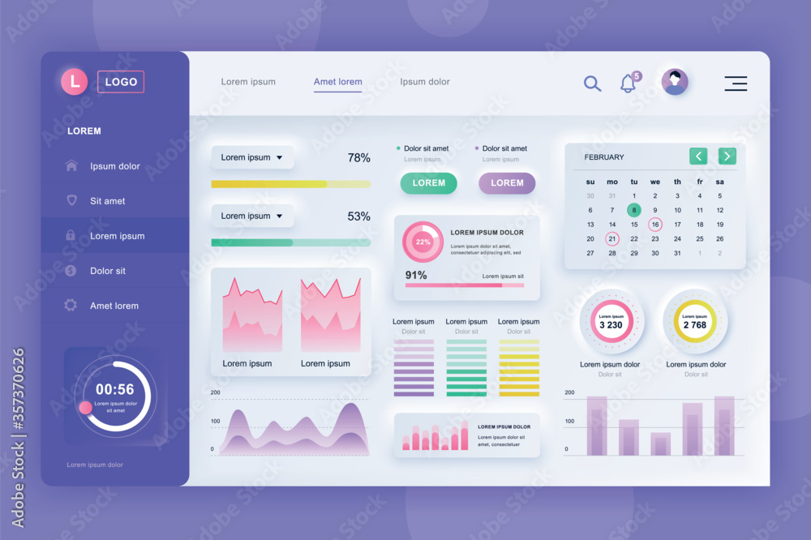

# ajogalehlauak - Neumorphic Admin Dashboard Template

Modern, clean, and responsive Neumorphic Admin Dashboard template built purely with HTML, CSS, and Vanilla JavaScript.



---

## 🌟 Fitur Utama

- **Neumorphism Design Language**: Menggunakan teknik soft shadow dan inset shadow yang presisi, halus, dan konsisten di seluruh antarmuka.
- **Responsif di Semua Perangkat**: Mendukung layar Ultra-wide Desktop, Laptop, Tablet, hingga Layar Ponsel (Mobile).
- **Sidebar Cerdas & Interaktif**:
  - Logo teks dinamis: Tampil sebagai `ajogalehlauak` saat sidebar terbuka dan otomatis bertransformasi menjadi `ajo` saat di-collapse.
  - Submenu accordion bertingkat.
  - Floating Tooltip melayang saat mode icon-only (hover preview nama menu).
  - Mode drawer melayang pada tampilan mobile/tablet.
- **Transisi Halaman Halus (Smooth Page Transitions)**: Efek fade-in antar navigasi halaman.
- **Koleksi Alert Neumorphic**: Varian notifikasi alert (Success, Info, Warning, Danger) yang dapat ditutup langsung.
- **Galeri Visualisasi Lengkap**:
  - Spline Smooth Area Wave Chart
  - Dual Mountain Peaks Chart
  - Circular Speedometer Gauges
  - Vertical Multi-Color Bar Chart
  - Donut Proportions Chart
  - Multi-Layer Stacked Progress Bars
- **Tabel Data Kaya Fitur**:
  - Floating Hover Rows Table dengan status badge dan pagination Neumorphic.
  - Compact Zebra-Striped Table untuk inventaris & data padat.
- **Halaman Error Siap Pakai**: 403 Forbidden, 404 Not Found, 500 Internal Error, dan 503 Maintenance.
- **Tanpa Ketergantungan Berat**: 100% murni HTML5, CSS3 kustom, dan Vanilla JS (tanpa framework berat).

---

## 📁 Struktur Berkas

```
neumorphic-admin-dashboard/
│
├── index.html          # Dashboard Utama (Fullscreen & Responsif)
├── charts.html         # Galeri Visualisasi Chart & Analitik
├── tables.html         # Koleksi Tabel Data & Inventaris
├── forms.html          # Komponen Form Input, Toggles, dan Kontrol
├── buttons.html        # Galeri Tombol Neumorphic & Palet Warna
├── blog.html           # Template Berita & Artikel
├── profile.html        # Halaman Profil Pengguna & Bio
│
├── 403.html            # Halaman Akses Ditolak (Forbidden)
├── 404.html            # Halaman Tidak Ditemukan (Not Found)
├── 500.html            # Halaman Kendala Server (Internal Server Error)
├── 503.html            # Halaman Pemeliharaan (Service Maintenance)
│
├── login.html          # Halaman Masuk Akun
├── register.html       # Halaman Pendaftaran Akun Baru
│
├── LICENSE             # Lisensi MIT ajogalehlauak
├── README.md           # Dokumentasi Proyek
│
└── asset/
    ├── style.css       # Seluruh stylesheet CSS Neumorphic + Responsive Breakpoints
    ├── script.js       # Interaktivitas JS (Sidebar Collapse, Tooltip, Submenu, Modal)
    └── img/
        └── logo-ajogalehlauak.jpg
```

---

## 🚀 Cara Menjalankan

Tidak memerlukan instalasi build tools (npm/webpack). Anda dapat langsung membuka file:

1. Clone repositori ini:
   ```bash
   git clone https://github.com/RimuruTempestCkCK/neumorphic-admin-dashboard.git
   ```
2. Buka folder proyek dan jalankan `index.html` langsung di browser favorit Anda, atau jalankan local server:
   ```bash
   # Menggunakan Python
   python -m http.server 8000
   
   # Atau menggunakan VS Code Live Server
   ```

---

## 📄 Lisensi

Proyek ini dilisensikan di bawah lisensi **MIT License** - Hak Cipta (c) 2026 **ajogalehlauak**. Lihat berkas [LICENSE](LICENSE) untuk informasi selengkapnya.
