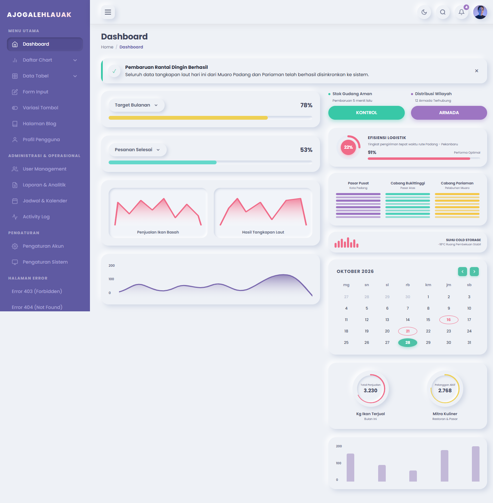
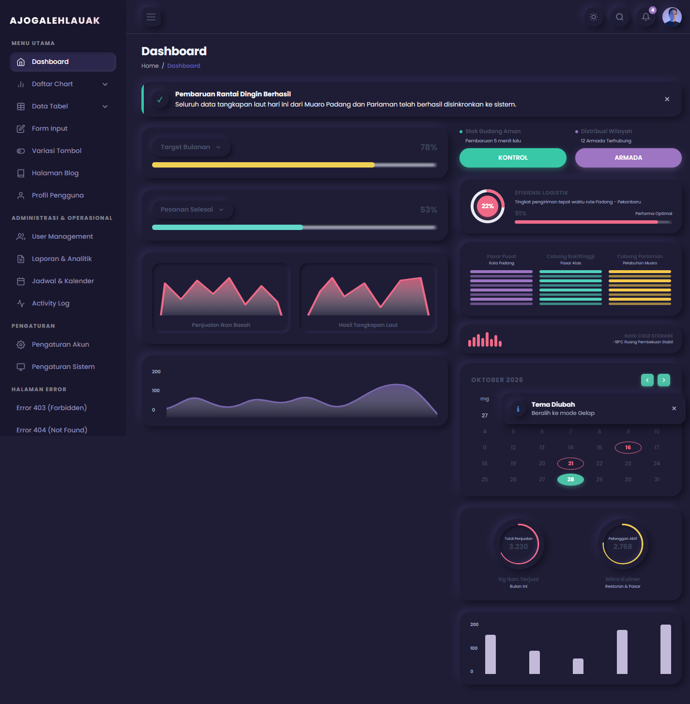
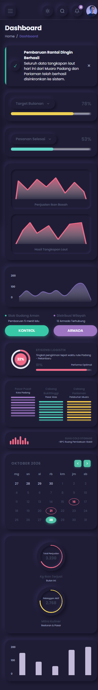

# ajogalehlauak - Neumorphic Admin Dashboard Suite

Modern, enterprise-grade, accessible, and responsive Neumorphic Admin Dashboard template built purely with HTML5, CSS3 Custom Properties, and Vanilla JavaScript (No heavy frameworks required).

Designed for fisheries, logistics cold-chain distribution, and operational command systems under the brand **ajogalehlauak**.

---

## 📸 Preview Dashboard

### Light Mode & Dark Mode
| Light Mode | Dark Mode |
| :---: | :---: |
|  |  |

### Tampilan Responsif (Mobile View)
<p align="center">
  
</p>

---

## 🌟 Fitur Utama & Arsitektur

### 1. Neumorphic Design System & Tokens
- **Soft Raised & Inset Shadows**: Penataan bayangan neumorphic yang terkontrol dengan kontras teks terjaga memenuhi rasio WCAG.
- **Dark Mode Lengkap**: Mode Gelap terintegrasi penuh dengan auto-sync `prefers-color-scheme` dan persistensi `localStorage`.
- **Theme Customizer Interaktif**:
  - Pilihan mode: Light, Dark, System Preference.
  - Pilihan warna aksen dinamis: Emerald Teal, Royal Violet, Atlantic Blue, Rose Red, Amber Coral.
  - Pengatur kelengkungan sudut (Border Radius): Kompak (14px), Standar (22px), Bulat (30px).
  - Tombol reset ke default bawaan.

### 2. Global Search & Command Palette (Ctrl+K / Cmd+K)
- Akses instan dari seluruh halaman dengan shortcut keyboard `Ctrl + K` (atau `Cmd + K` di macOS) atau ikon pencarian topbar.
- Pencarian cerdas navigasi menu, manajemen data, aksi cepat (Toggle Dark Mode, Kustomisasi Tema, Tambah Pengguna).
- Navigasi hasil menggunakan tombol keyboard `Arrow Up`, `Arrow Down`, `Enter`, dan `Escape`.

### 3. Notification Center & Toast Feedback
- **Notification Center Drawer**: Drawer kanan interaktif menampilkan notifikasi operasional berkategori (Success, Danger, Info, Warning) dengan tanda waktu relatif dan status *unread*.
- **Aksi Tandai Dibaca**: Tombol "Tandai Semua Dibaca" memperbarui badge notifikasi secara real-time.
- **Toast Notification Engine**: Notifikasi mengambang dengan durasi otomatis dan tombol tutup instan.

### 4. Advanced Table Controller (`AjoTableController`)
- **Pencarian Real-Time (Debounced)**: Penyaringan instan berdasarkan multi-kolom tanpa lag.
- **Multi-Filter Status & Kategori**: Penyaringan fleksibel untuk status pengiriman dan ketersediaan stok.
- **Pengurutan Kolom (Sorting)**: Urutkan data secara ascending dan descending hanya dengan mengklik header tabel.
- **Paginasi Dinamis**: Dukungan pemilihan ukuran halaman (5, 10, 25 baris per halaman) serta tombol navigasi nomor halaman.
- **Ekspor CSV**: Mengunduh seluruh data tabel terfilter menjadi file `.csv` terstruktur.

### 5. Lapisan Layanan Data (`AjoApiService` & Mock Storage)
- **Terpusat di `asset/data/mock-data.js`**: Menyimpan master data Pengguna, Inventaris Ikan Laut, Pesanan Restoran, Telemetri Sensor Suhu IoT, Agenda Kalender, Catatan Aktivitas Audit, dan Ringkasan Analitik.
- **Service Adapter (`asset/js/api-service.js`)**: Arsitektur REST API adapter yang siap disambungkan ke backend produksi (Laravel, Express, NestJS, Go, FastAPI, Django) hanya dengan mengubah konfigurasi `useMock: false`.

---

## 📂 Katalog Halaman Lengkap

| Halaman | Berkas | Deskripsi |
| :--- | :--- | :--- |
| **Dashboard Utama** | `index.html` | Ringkasan KPI tonase, grafik penjualan harian, status armada berpendingin, dan kalender mini. |
| **User Management** | `users.html` | Manajemen staf dan mitra restoran dengan modal tambah pengguna, pencarian, dan paginasi. |
| **Data Tabel** | `tables.html` | Tabel interaktif pesanan logistik dan inventaris rak cold storage dengan `AjoTableController`. |
| **Laporan & Analitik** | `reports.html` | Breakdown tonase komoditas laut, estimasi omset penjualan, dan unduh CSV analitik. |
| **Jadwal & Kalender** | `calendar.html` | Kalender bulanan jadwal pendaratan kapal tangkap, inspeksi cold storage, dan checklist tugas. |
| **Audit Activity Log** | `activity-log.html` | Jejak audit keamanan & operasional sistem lengkap dengan user, aksi, IP, dan ekspor CSV. |
| **Pengaturan Akun** | `account-settings.html` | Pengaturan profil admin, unggah avatar profil, zona waktu, dan formulir ubah kata sandi. |
| **Pengaturan Sistem** | `system-settings.html` | Konfigurasi ambang batas alarm suhu IoT, interval sensor, dan pengalihan mode REST API. |
| **Daftar Grafik** | `charts.html` | Showcase Spline wave chart, speedometer gauges, dual peak chart, bar chart, dan donut chart. |
| **Formulir Input** | `forms.html` | Form input komoditas laut baru dengan validasi instan, counter karakter, dan toggle IoT. |
| **Variasi Tombol** | `buttons.html` | Katalog variasi tombol Neumorphic raised, inset, pill, outline, icon, dan color accents. |
| **Blog & Berita** | `blog.html` | Tampilan kartu artikel berita maritim dan panduan mutu rantai dingin. |
| **Profil Pengguna** | `profile.html` | Kartu profil anggota tim dan log aktivitas personal. |
| **Login & Register** | `login.html`, `register.html` | Tampilan autentikasi responsif dengan simulasi login interaktif. |
| **Halaman Error** | `403.html`, `404.html`, `500.html`, `503.html` | Template error status kode HTTP profesional. |

---

## 🚀 Cara Menjalankan

Template ini tidak memerlukan dependensi build tools (npm / Node.js / webpack) sehingga dapat dijalankan langsung:

1. Clone repositori ini:
   ```bash
   git clone https://github.com/RimuruTempestCkCK/neumorphic-admin-dashboard.git
   cd neumorphic-admin-dashboard
   ```
2. Buka berkas `index.html` langsung di browser, atau gunakan web server statis:
   ```bash
   # Menggunakan Python 3
   python -m http.server 8000
   
   # Atau menggunakan PHP built-in server
   php -S localhost:8000
   ```
3. Buka browser dan arahkan ke `http://localhost:8000`.

---

## ⌨️ Pintasan Keyboard (Shortcuts)

- `Ctrl + K` / `Cmd + K`: Membuka / menutup Command Palette.
- `Escape`: Menutup modal aktif, dialog konfirmasi, atau Command Palette.
- `Arrow Up` / `Arrow Down`: Menavigasi pilihan pada Command Palette.
- `Enter`: Menjalankan aksi terpilih pada Command Palette.

---

## 📄 Lisensi

Proyek ini dilisensikan di bawah lisensi **MIT License** - Hak Cipta (c) 2026 **ajogalehlauak**. Lihat berkas [LICENSE](LICENSE) untuk informasi selengkapnya.
